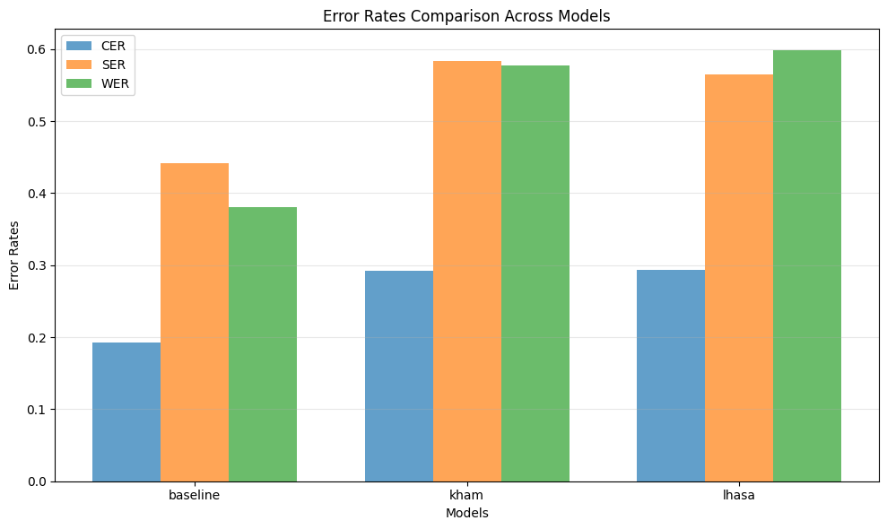

# Garchen STT Report 10.18.25

## Summary

**Description:** This report describes the results of finetuning STT models on general data to determine the benefit to Garchen Rinpoche specific STT. 

**Results**: Finetuning on general data provides no benefit.

**Recommendations**: Unsupervised pretraining should be held off until unsupervised data of Garchen Rinpoche is available. Next steps should be to further finetune on existing Garchen Rinpoche data then investigate the addition of a language model for post-processing.

## Methods

### Data

There were two datasets used for training:

1. **Kham** material was extracted from ['ganga4364/stt_tibetan_dialects_data'](https://huggingface.co/datasets/ganga4364/stt_tibetan_dialects_data)
2. **Lhasa** material was used from [NICT-Tib1](https://ast-astrec.nict.go.jp/en/release/NICT-Tib1/)

The dataset for evaluation is the 'validation' split of ['ganga4364/garchen_rinpoche_data_20hours'](https://huggingface.co/datasets/ganga4364/garchen_rinpoche_data_20hours).

### Metrics

The metrics used for these experiments were Character Error Rate, Syllable Error Rate, and Word Error Rate.

Character Error Rate (CER): The percentage of characters that were incorrectly recognized in the transcription compared to the reference text.

Syllable Error Rate (SER): The percentage of syllables that were incorrectly recognized in the transcription compared to the reference text.

Word Error Rate (WER): The percentage of words that were incorrectly recognized in the transcription compared to the reference text.

### Models

The model used for these experiments was ["openpecha/Garchen_Rinpoche_stt"](https://huggingface.co/openpecha/Garchen_Rinpoche_stt), the best performing model in [previous testing](https://forum.openpecha.org/t/asr-model-evaluation-report-for-garchen-rinpoche/435/4). This model is a [Wav2Vec2-XLS-R-300m](https://huggingface.co/facebook/wav2vec2-xls-r-300m) finetuned first on general Tibetan material, then on 20 hrs of Garchen Rinpoche's speech.

### Experiment Set Up

The model was re-evaluated to provide a baseline result. Then the model was finetuned for 1 epoch on the Kham data. The baseline model was also finetuned on the Lhasa data. This resulted in two new models, a **Kham** model and a **Lhasa** model.

Training arguments are shown below.

```python
 training_args = TrainingArguments(
    per_device_train_batch_size=2,
    gradient_accumulation_steps=8, 
    learning_rate=1e-4,
    warmup_steps=500,
    num_train_epochs=1,
    gradient_checkpointing=True,
    fp16=True,
    save_strategy='epoch',
)
```

## Results

Model |CER |SER|WER
---|---|---|---
baseline	|0.1927|	0.4417|	0.3801
kham|	0.2927|	0.5832|	0.5778
lhasa|	0.2932|	0.5647|	0.5979




Both models with additional training worsened on every metric with respect to the baseline, though the worsening is roughly the same with both datasets.

## Discussion

Training on general data in any dialect is unlikely to be beneficial in either a supervised or unsupervised approach. Further work should focus on using Garchen Rinpoche specific data.

The most viable path forward appears to be to finetune on the additional Garchen Rinpoche data that is now available. Additionally, the addition of a language model to the pipeline should be investigated.